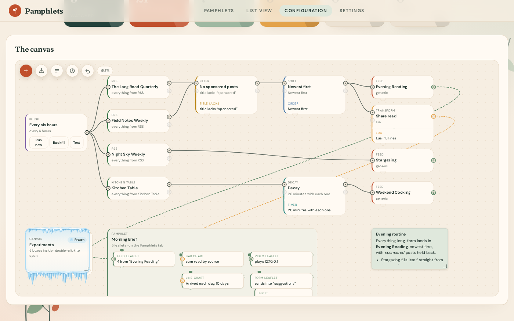
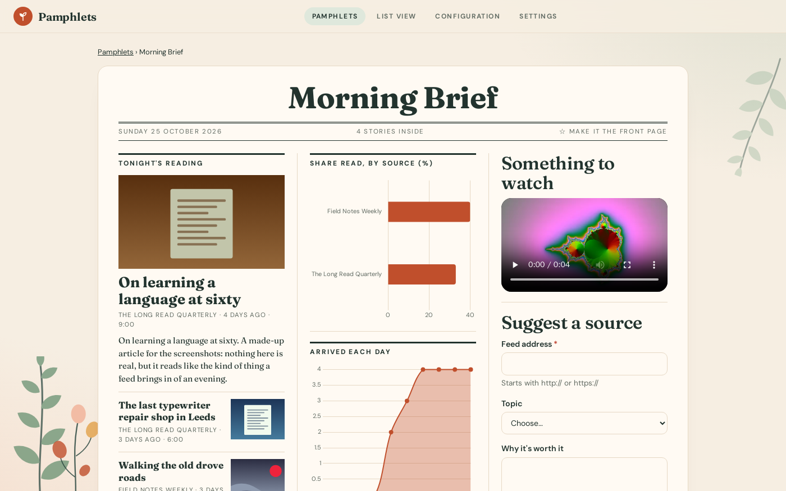
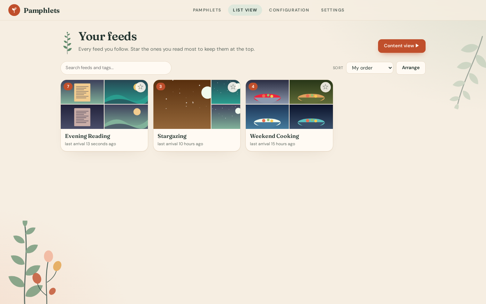
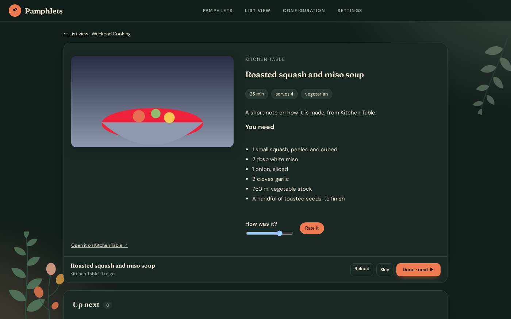
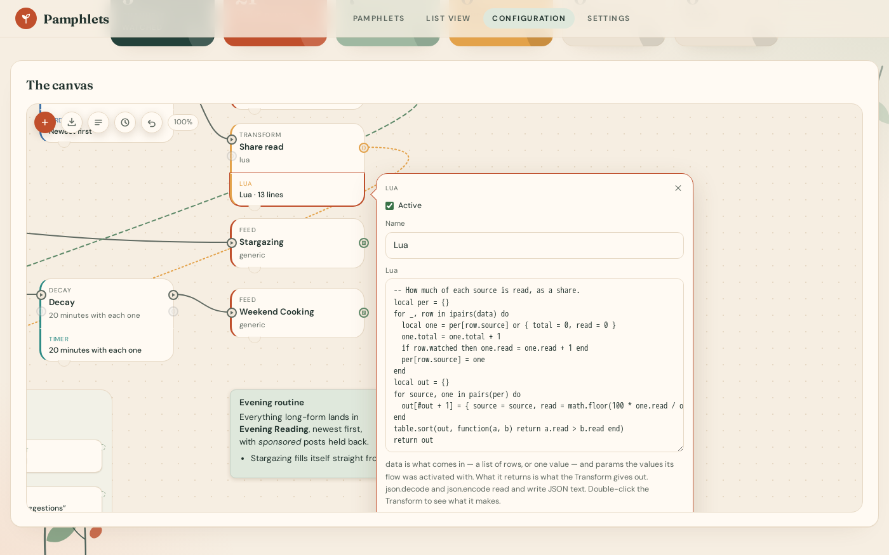
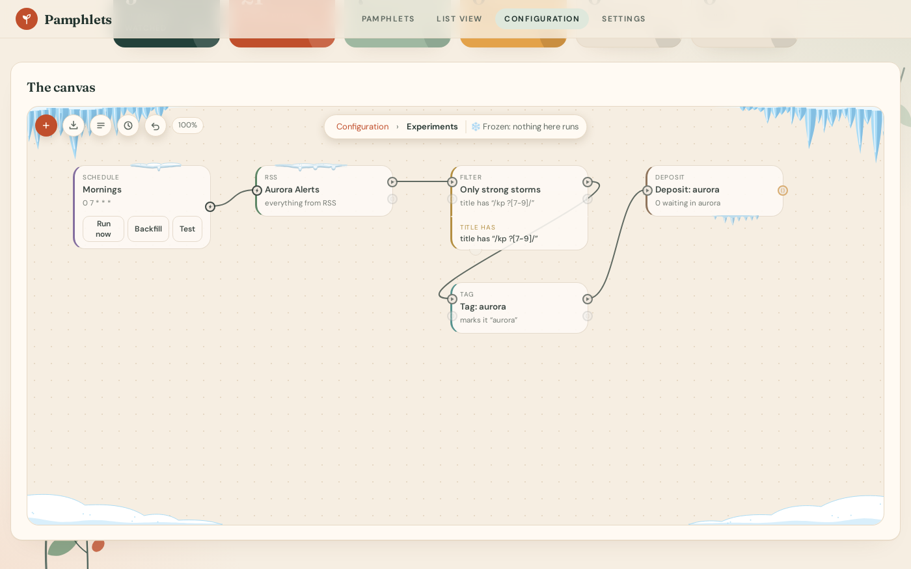
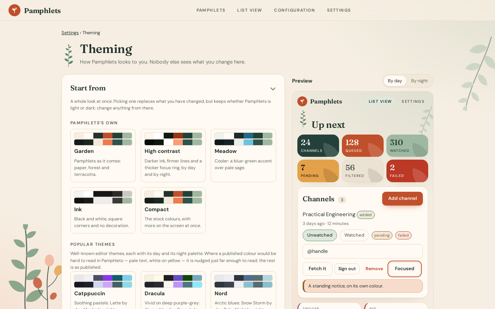
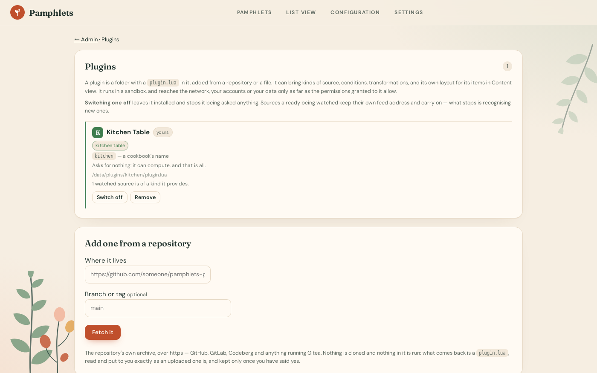

# Pamphlets

**Your feeds, wired by you. No algorithm in the loop.**

Pamphlets follows the newsletters, feeds and APIs you choose — and anything else a plugin can
read — and fills feeds you own with
exactly what they publish: filtered, ordered and paced the way you decide. Nothing is recommended,
nothing is injected, nothing autoplays into the next rabbit hole.

It is self-hosted: one container, one database, your server.

<p align="center">
  
</p>

<table>
  <tr>
    <td align="center"><a href="docs/wiki/The%20Configuration%20Canvas.md"></a><br><sub>The canvas</sub></td>
    <td align="center"><a href="docs/wiki/Nodes/Pamphlets.md"></a><br><sub>Pamphlets</sub></td>
    <td align="center"><a href="docs/wiki/List%20View.md"></a><br><sub>List view</sub></td>
    <td align="center"><a href="docs/wiki/Content%20View.md"></a><br><sub>Content view</sub></td>
  </tr>
  <tr>
    <td align="center"><a href="docs/wiki/Nodes/Transform.md#lua"></a><br><sub>Lua transforms</sub></td>
    <td align="center"><a href="docs/wiki/Nodes/Canvases%20and%20Relays.md#freezing-a-canvas"></a><br><sub>Frozen canvases</sub></td>
    <td align="center"><a href="docs/wiki/Theming.md"></a><br><sub>Theming</sub></td>
    <td align="center"><a href="docs/wiki/Plugins.md"></a><br><sub>Plugins</sub></td>
  </tr>
</table>

---

## Why Pamphlets

- **You choose what arrives.** Only the sources you follow. No "you might also like".
- **You see how it works.** Your setup is a visual flow on the Configuration canvas: sources on the
  left, feeds on the right, every rule in between visible as a box. If something arrives, you can
  point at the wire it came down. Canvases nest inside canvases, and one can be **frozen** — nothing
  inside it runs — while you think it over.
- **You set the pace.** Limit a feed to ninety minutes a day, open it only in the evening, give each
  post a few minutes before moving on, let items expire, or hold them back and release a few at a
  time.
- **Pages of your own.** A **pamphlet** lays out feeds, charts, maps, a video, notes and forms on a
  page, from what your flows bring in. A form's answers come back in as a source of their own.
- **Work things out.** Count, reshape and total what arrives with a **Transform** — a piece of Lua
  of your own, or a plugin's — and chart it. One flow can **activate** another with values of its
  choosing, and get an answer back.
- **Extend it safely.** Plugins written in Lua add sources, filter conditions, transformations, and
  their own layout for their items in Content view (XML and CSS), and a player for their videos. Each runs in a sandbox, granted
  only the permissions an admin approves, and installs straight from a repository.
- **It can write back.** A plugin can fill playlists on its own service, so what you choose is
  waiting wherever you watch. Reading sources is free; a service's quota is only spent on writing,
  and a ledger keeps it from running out mid-run.
- **Share it with your household.** Separate private accounts on one instance; the admin manages
  accounts, not anyone's feeds.
- **Read offline.** Install it as an app on your phone; pages you have opened stay readable.

## How it works

```
 Trigger ──▶ Source ──▶ Filter ──▶ Sort ──▶ Feed ──▶ you: List view, Content view, a pamphlet
 (when)      (where)    (what)    (order)   (where it lands, with Timer / Reset / Alive)
                           └──▶ Transform {Lua} ──▶ a chart on a pamphlet
```

1. A **trigger** decides when to check a source — on a pulse, on a schedule, or when another flow
   activates it.
2. New items flow along the **wires** you drew, through **Filter**, **Sort**, **Tag**, **Decay**
   and **Expire** boxes.
3. They land in **feeds** — inside Pamphlets, or (through a plugin) in a playlist on its service.
4. You browse them in **List view**, go through them one at a time in **Content view**, or read a
   **pamphlet** of your own.

## Quick start

```bash
git clone <this repository> pamphlets && cd pamphlets
cp .env.example .env          # optional: sign-in, and plugin settings
make up                       # build, start, wait until healthy
```

Open <http://localhost:8080>, go to **Configuration**, and drop a **Source**, a **Feed** and a
**Trigger** onto the canvas. Wire Trigger → Source → Feed, switch the Source on (new sources start
off), and press ▶ on the trigger.

None of the plugins come built in: add the ones you want under **Admin → Plugins**, from their
repositories — see [Plugins](docs/wiki/Plugins.md).

Full walkthrough: [Installing](docs/wiki/Installing.md).

## Documentation

| For | Start here |
| --- | --- |
| **Using Pamphlets** — every feature, one page each | [User Wiki](docs/wiki/README.md) |
| **Writing plugins** — sources, conditions, transformations, Content-view layouts, players, the Lua API | [Creating A Plugin](docs/wiki/Creating%20A%20Plugin/GETTING%20STARTED.md) |
| **Working on Pamphlets** — architecture, systems, algorithms, decisions | [Internal Documentation](docs/internal/README.md) |
| **API reference** — generated from the code (`make docs`) | [autodoc](docs/internal/autodoc/README.md) |
| **Every page, at a glance** | Tables of contents: [wiki](docs/wiki/Table%20of%20Contents.md) · [internal](docs/internal/Table%20of%20Contents.md) |
| **What's broken or missing** | [Known Issues](docs/internal/Known%20Issues.md) |

The screenshots are of a made-up demo, retaken with `make screenshots`.

## Built with

Python 3.12 · FastAPI · SQLAlchemy · SQLite · APScheduler · htmx · TypeScript · Lua 5.5 (lupa) ·
Docker

## License

MIT — see [LICENSE](LICENSE).
